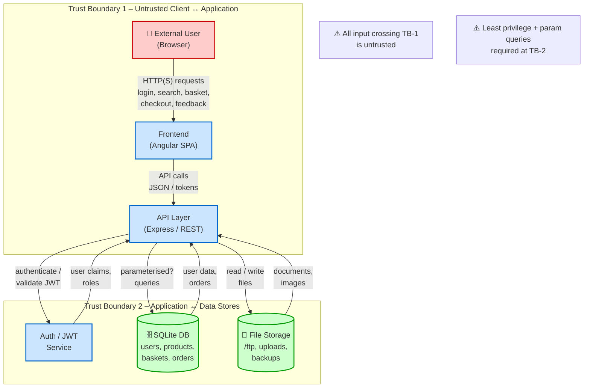

# Data Flow Diagram – Editable Source (Mermaid)

Copy the Mermaid block below into any Mermaid-compatible renderer (GitHub, VS Code, draw.io import, mermaid.live, etc.) to obtain a PNG/PDF.

## How the diagram maps to the fictional college fest ticketing site

- **Users** = students, staff, ticket buyers, administrators
- **Web Application** = the ticketing frontend + backend that handles registration, ticket selection, basket, payment, and order history
- **Database** = accounts, ticket inventory, orders, payment records
- **File storage** = uploaded ID documents, event posters, backup exports, receipts

Trust boundaries remain identical: anything coming from a browser is untrusted; the database and file store sit behind the application and must be protected by proper access controls and input handling.